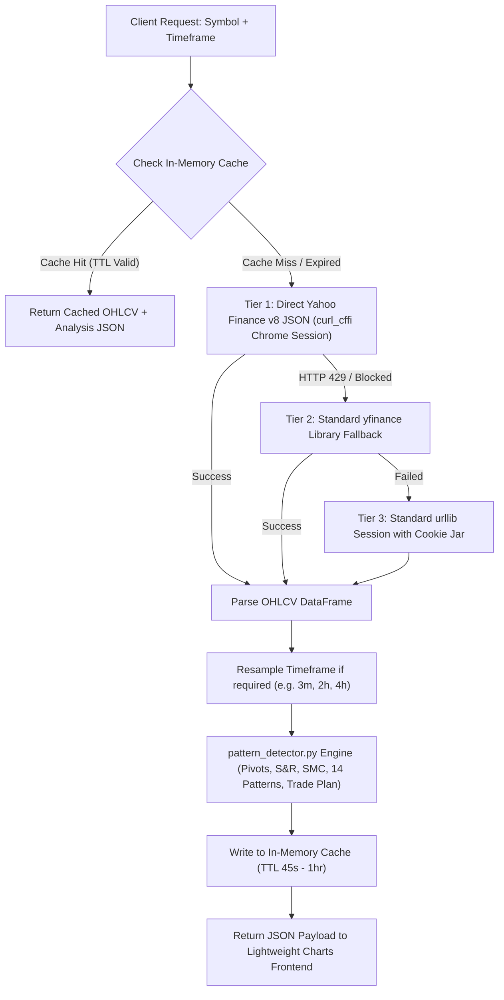

# AI Price Action & TechnoFunda Charting Terminal (Version 1.1)

A self-hosted, professional-grade, TradingView-style interactive charting and batch market screening terminal built with **Python Flask**, **TradingView Lightweight Charts (v5.1.0)**, and **Yahoo Finance (`yfinance`)**.

The terminal features automated detection of **14 classical & modern chart patterns**, **Smart Money Concepts (SMC)** market structure (`HH`, `HL`, `LH`, `LL`, `BOS`, `CHoCH`), **dynamic viewport Support & Resistance**, **multi-touch trendlines**, **algorithmic trade planning levels**, and **high-speed batch market screeners** across the entire National Stock Exchange (NSE) of India universe (2,200+ equities & official index baskets)—**100% free, requiring zero broker API keys or paid data subscriptions**.

---

## Table of Contents

1. [Key Features & Capabilities](#key-features--capabilities)
2. [System & Software Prerequisites](#system--software-prerequisites)
3. [Project Folder Structure](#project-folder-structure)
4. [Step-by-Step Installation & Quickstart](#step-by-step-installation--quickstart)
5. [Charting Workspace & User Interface](#charting-workspace--user-interface)
   - [Top Navigation Bar](#top-navigation-bar)
   - [Preset View Modes](#preset-view-modes)
   - [Left Manual Drawing Rail](#left-manual-drawing-rail)
   - [Right Pattern Navigator](#right-pattern-navigator)
   - [Interactive Legend & Trade Plan Overlay](#interactive-legend--trade-plan-overlay)
   - [Keyboard Shortcuts & Navigation](#keyboard-shortcuts--navigation)
6. [Built-In Market Scanners](#built-in-market-scanners)
   - [1. Multi-Scale Cup & Handle Screener](#1-multi-scale-cup--handle-screener)
   - [2. Multi-Year Breakout (MYB) Scanner](#2-multi-year-breakout-myb-scanner)
   - [3. Weekly HL / LL & Reversal Forecast Scanner](#3-weekly-hl--ll--reversal-forecast-scanner)
   - [Dockable Scanner Panel & Excel Export](#dockable-scanner-panel--excel-export)
7. [Supported Chart Patterns (14 Formations)](#supported-chart-patterns-14-formations)
8. [Historical Backtesting Engine (`backtester.py`)](#historical-backtesting-engine-backtesterpy)
9. [Multi-Tier Market Data Pipeline & Architecture](#multi-tier-market-data-pipeline--architecture)
10. [Configuration & Customization](#configuration--customization)
11. [Troubleshooting & Frequently Asked Questions](#troubleshooting--frequently-asked-questions)
12. [Disclaimer](#disclaimer)

---

## Key Features & Capabilities

* **Resilient Multi-Tier Market Data Pipeline:**
  Direct integration with Yahoo Finance v8 JSON endpoints (`query1`/`query2`) using browser impersonation via `curl_cffi`, transparent failover to `yfinance`, and timeframe-aware in-memory caching to eliminate HTTP 429 rate limits.
* **Full NSE Equity Universe (2,200+ Stocks & Indices):**
  Automatic synchronization of the official NSE `EQUITY_L.csv` and constituent index baskets (Nifty 50, Nifty 100, Nifty Midcap 150, Nifty Smallcap 250, Nifty 500, Nifty 750 Total Market). Global tickers (e.g., `AAPL`, `NVDA`, `BTC-USD`, `GC=F`) are also supported.
* **11 Multi-Timeframe Horizons:**
  `1m`, `3m`, `5m`, `15m`, `30m`, `1H`, `2H`, `4H`, `D` (Daily), `W` (Weekly), and `M` (Monthly).
* **Dynamic Viewport Support & Resistance:**
  Recalculates price clusters and touch counts (e.g., `R 26,311 · 5x`, `S 24,510 · 12x`) on-the-fly as you pan or zoom across candles.
* **Smart Money Concepts (SMC) & Market Structure:**
  Automatic labeling of swing extremes (`HH`, `HL`, `LH`, `LL`), Break of Structure (`BOS`), Change of Character (`CHoCH`), and 3+ touch trendlines.
* **14 Algorithmic Chart Patterns:**
  Includes Ascending/Descending/Symmetrical Triangles, Head & Shoulders, Inverse Head & Shoulders, Bull & Bear Flags, Double Tops & Bottoms, Rounding Tops & Bottoms, Rising & Falling Wedges, and Multi-Scale Cup & Handle with cheat entries.
* **Trade Plan Engine:**
  Plots Entry, Stop Loss (SL), Trailing Stop Loss (TSL), and 3 Target price levels (`T1`, `T2`, `T3`) directly onto the chart and top legend.
* **3 Institutional Batch Market Scanners:**
  Batch screen entire index baskets for Cup & Handle cheat stages, Multi-Year Breakouts (2Y, 3Y, 5Y, ATH), and Weekly Higher/Lower Low reversal setups.
* **Dockable Side-by-Side Screening:**
  Dock scanner results to the right side of the screen with a resizable drag handle to inspect charts and scanner hits simultaneously.
* **Comprehensive Drawing Rail:**
  Manual Trendlines, Horizontal Rays, Supply/Demand Zone Boxes, Fibonacci Retracements, and Freehand Brush with Hide/Show, Undo, and Delete All controls.
* **One-Click Excel Export:**
  Download all filtered scanner results into clean `.xlsx` / `.csv` format for post-market analysis.

---

## System & Software Prerequisites

| Component | Minimum Specification | Recommended Specification |
| :--- | :--- | :--- |
| **Operating System** | Windows 10/11, macOS 11+, or Linux (Ubuntu 20.04+) | Windows 11 / macOS 13+ / Linux |
| **Python Runtime** | Python 3.10 | Python 3.11, 3.12, or 3.13 |
| **Package Manager** | `pip` (bundled with Python) | Latest `pip` (`python -m pip install --upgrade pip`) |
| **Web Browser** | Chrome 100+, Edge 100+, Firefox 100+, Brave, Safari 15+ | Google Chrome or Microsoft Edge |
| **Network** | Broadband internet | Required for Yahoo Finance data and TradingView CDN |
| **Hardware** | 4 GB RAM, 2-core CPU | 8 GB+ RAM, modern multi-core CPU |

> [!IMPORTANT]
> **Windows Installation Note:** When installing Python from [python.org](https://www.python.org/downloads/), make sure to check **"Add Python to PATH"** on the first setup screen. Otherwise, the `python` and `pip` commands will not be recognized in PowerShell or Command Prompt.

---

## Project Folder Structure

Organize your project directory as follows:

```text
Price Action/
├── app.py                          # Flask application server, caching engine, NSE CSV fetcher & REST APIs
├── pattern_detector.py             # Pivot detection, dynamic S&R, SMC structure, 14 chart patterns & scanner algorithms
├── backtester.py                   # Event-driven historical backtesting engine with risk management & reports
├── requirements.txt                # Required Python packages
├── README.md                       # Base documentation
├── Readme Version 1.1.md           # Detailed user guide and architectural manual (this document)
├── nse_stocks_cache.json           # Auto-generated cache of 2,200+ NSE symbols (created on first run)
├── nse_baskets_cache.json          # Auto-generated cache of NSE index constituent lists (created on first run)
├── backtest_results/               # Auto-generated directory containing exported trade logs (.csv)
└── templates/
    └── index.html                  # Single-page frontend (TradingView Lightweight Charts v5.1.0 + scanner modals)
```

### Python Package Dependencies (`requirements.txt`)

```text
flask==3.1.0
yfinance==0.2.54
pandas==2.2.3
numpy==2.2.3
scipy==1.15.2
curl_cffi>=0.7.0
```

* **`flask`**: Serves the single-page application and handles REST API endpoints for chart data and batch scanning.
* **`yfinance`**: Fetches historical and intraday stock/index OHLCV bars.
* **`pandas`**: Normalizes market data, handles rolling calculations (SMA, RSI), and resamples intraday bars.
* **`numpy`**: High-performance vectorized numerical operations and polynomial curve fitting.
* **`scipy`**: `argrelextrema` for pivot detection and `linregress` for trendline slope calculations.
* **`curl_cffi`**: Performs TLS-fingerprint browser impersonation to prevent HTTP 429 / 403 blocks from Yahoo Finance and NSE archives.

---

## Step-by-Step Installation & Quickstart

### Step 1: Open Terminal in the Project Directory

* **Windows:** Press `Win + X`, select **Terminal** or **PowerShell**, and navigate to the project directory:
  ```powershell
  cd "d:\Personal\PriceAction"
  ```
* **macOS / Linux:** Open Terminal and run:
  ```bash
  cd "/path/to/PriceAction"
  ```

### Step 2: Set Up and Activate a Python Virtual Environment (Recommended)

Using an isolated virtual environment prevents library conflicts:

* **Windows (Command Prompt / PowerShell):**
  ```powershell
  python -m venv venv
  venv\Scripts\activate
  ```
  *(Upon activation, your prompt will show `(venv)` at the beginning of the line).*

* **macOS / Linux:**
  ```bash
  python3 -m venv venv
  source venv/bin/activate
  ```

### Step 3: Install Required Dependencies

Run:
```bash
pip install -r requirements.txt
```
Or install the packages directly:
```bash
pip install flask yfinance pandas numpy scipy curl_cffi
```

> [!TIP]
> Ensure `yfinance` and `curl_cffi` are on their latest releases to avoid changes in Yahoo Finance's scraping headers:
> ```bash
> pip install --upgrade yfinance curl_cffi
> ```

### Step 4: Launch the Application Server

Start the Flask server:
```bash
python app.py
```

**First-Run Initialization:**
On the very first launch, `app.py` automatically downloads the latest official NSE master equity list (`EQUITY_L.csv` with over 2,200 stocks) and official index constituent baskets (Nifty 50, Nifty 100, Nifty Midcap 150, Nifty Smallcap 250, Nifty 500, Nifty 750). It writes them to `nse_stocks_cache.json` and `nse_baskets_cache.json`. Subsequent boots load instantly from these local files.

Once initialized, the terminal console will output:
```text
 * Serving Flask app 'app'
 * Debug mode: on
 * Running on http://127.0.0.1:5000 (Press CTRL+C to quit)
```

### Step 5: Automatic Browser Launch

When you run `python app.py`, the terminal will **automatically detect when the server is ready and launch your default web browser** to:
```text
http://127.0.0.1:5000
```

*(If you ever need to open it manually, simply visit `http://127.0.0.1:5000` in Google Chrome, Edge, Brave, or Firefox).*

The terminal opens immediately to **NIFTY 50 (`^NSEI`)** on the **Daily (`D`)** timeframe with automated price action layers active.

To stop the server at any time, return to your terminal and press `Ctrl + C`.

---

## Charting Workspace & User Interface

The terminal features a 3-column responsive layout built specifically for active price action traders:

```
┌────────────────────────────────────────────────────────────────────────────────────────┐
│  [Search Stock] [Go]  [1m..M Timeframes]  [Clean|Structure|Patterns|Everything]  [Scanners▾] [Indicators▾] [Patterns (N)] │
├─────┬───────────────────────────────────────────────────────────────────┬──────────────┤
│  L  │  [Top-Left Legend: Symbol · TF · OHLCV · Trade Plan]               │  Chart       │
│  e  │                                                                   │  Patterns    │
│  f  │                                                                   │  List &      │
│  t  │                     TradingView Chart Canvas                      │  Navigation  │
│     │               (Candlesticks, Dynamic S&R, SMC,                    │              │
│  T  │                 Trendlines, Pattern Overlays)                     │  (Click to   │
│  o  │                                                                   │   zoom to    │
│  o  │                                                                   │   pattern)   │
│  l  │                                                                   │              │
│  s  │  [Bottom Nav Controls: Zoom In/Out, Pan Left/Right, Reset (Alt+R)]│              │
└─────┴───────────────────────────────────────────────────────────────────┴──────────────┘
```

### Top Navigation Bar

* **Searchable Stock Dropdown:**
  Click the symbol box (default `^NSEI`). Type any ticker (e.g. `RELIANCE`, `TCS`, `HDFCBANK`, `TATAMOTORS`, `ZOMATO`) or company name. Plain NSE symbols automatically append `.NS`. You can also enter global symbols such as `NVDA`, `AAPL`, `MSFT`, `BTC-USD`, or `GC=F`. Press `Enter` or click **Go**. Click the `✕` icon to clear the input and browse the full stock list.
* **11 Timeframe Selectors:**
  Switch between `1m`, `3m`, `5m`, `15m`, `30m`, `1H`, `2H`, `4H`, `D`, `W`, and `M`. Intraday timeframes (`3m`, `2h`, `4h`) are resampled seamlessly by the backend.
* **Scanners ▾ Dropdown:**
  Quick-launch buttons for:
  1. *Cup & Handle Screener*
  2. *Multi-Year Breakout Scanner*
  3. *Weekly HL / LL Scanner*
* **Indicators ▾ Popover:**
  Toggle individual analysis layers:
  - Dynamic Support & Resistance
  - Swings (`HH`/`HL`/`LH`/`LL`) & `BOS`/`CHoCH`
  - Auto Trendlines (3+ touches)
  - Volume Histogram
  - Trade Plan Levels (`Entry`, `SL`, `TSL`, `T1`, `T2`, `T3`)
  - 14 Individual Chart Patterns (with **All** / **None** buttons and a "Cup & Handle: latest only" toggle)
* **Patterns (N) Button:**
  Toggles the collapsible right sidebar showing all patterns currently detected on the visible chart.

### Preset View Modes

Quickly adjust the chart's visual density with one click:

| Preset Mode | Description & Active Layers |
| :--- | :--- |
| **Clean** | Raw candlesticks and volume only. Ideal for uncluttered manual chart reading. |
| **Structure** | Displays market structure: Dynamic S&R zones, SMC Swings (`HH`/`HL`/`LH`/`LL`), `BOS`/`CHoCH` levels, and Auto Trendlines. |
| **Patterns** | Displays all 14 detected chart patterns and their geometry, hiding swing markers. |
| **Everything** | Enables every analytical layer: S&R, SMC, Trendlines, Patterns, and Trade Plans. |
| **Custom** | Remembers your custom selections made inside the **Indicators ▾** dropdown. |

### Left Manual Drawing Rail

Use the left toolbar to draw your own technical analysis directly on the chart:

* **Cursor / Crosshair (`V`):** Default interactive chart navigation mode.
* **Trendline (`L`):** Click and drag to draw custom trendlines.
* **Horizontal Ray (`H`):** Click to cast an infinite horizontal support/resistance ray across the price axis.
* **Rectangle / Supply-Demand Box (`B`):** Click and drag to highlight consolidation blocks or order blocks.
* **Fibonacci Retracement (`F`):** Click and drag between swing low and swing high to plot standard Fibonacci levels (`0.0%`, `23.6%`, `38.2%`, `50.0%`, `61.8%`, `78.6%`, `100.0%`).
* **Freehand Brush (`P`):** Draw freehand annotations and markup on the canvas.
* **Hide / Show Drawings (`Eye` icon):** Temporarily hide manual drawings without deleting them.
* **Undo Last Drawing (`Ctrl + Z` icon):** Removes the most recently placed drawing.
* **Delete All Drawings (`Trash` icon):** Clears all drawings from the current chart.

### Right Pattern Navigator

Clicking **Patterns (N)** in the top-right toolbar opens a dedicated sidebar listing every pattern detected in the current timeframe:
* Displays pattern name, bias indicator (Bullish in green, Bearish in red, Neutral in yellow), and date range.
* Clicking any pattern card **instantly centers and zooms the chart** directly onto that pattern's coordinates.

### Interactive Legend & Trade Plan Overlay

* **Top-Left Legend:**
  Shows real-time values for Open, High, Low, Close, Volume, and percentage change of the active or hovered candle.
* **Algorithmic Trade Plan Overlay:**
  When a chart pattern or structural breakout is detected, the terminal computes an institutional trade setup:
  - **Entry:** Breakout rim or cheat level price.
  - **SL (Stop Loss):** Structural invalidation level (e.g. handle low or recent swing trough).
  - **TSL (Trailing Stop Loss):** Breakeven / dynamic protection level.
  - **T1 / T2 / T3:** Multi-target measured moves based on pattern height and depth.

### Keyboard Shortcuts & Navigation

| Action | Shortcut / Control |
| :--- | :--- |
| **Zoom In** | `+` or `=` key / Mouse Wheel Up / Floating Zoom-In button |
| **Zoom Out** | `-` key / Mouse Wheel Down / Floating Zoom-Out button |
| **Scroll / Pan Left** | `←` Left Arrow key / Drag Chart Canvas Left |
| **Scroll / Pan Right** | `→` Right Arrow key / Drag Chart Canvas Right |
| **Reset View** | `Alt + R` / Bottom Floating Reset button (restores default zoom & offset) |
| **Close Popovers / Modals** | `Esc` key |
| **Submit Symbol Search** | `Enter` key |

---

## Built-In Market Scanners

Click **Scanners ▾** in the top bar to launch any of the three institutional batch screeners.

Each scanner allows you to select an **Index Basket**:
* **Nifty 50** (~50 large-cap bluechips)
* **Nifty 100** (~100 top liquid equities)
* **Nifty Midcap 150** (~150 high-growth mid-cap companies)
* **Nifty Smallcap 250** (~250 emerging small-cap equities)
* **Nifty 500** (~500 broad-market leaders)
* **Nifty 750 Total Market** (~750 comprehensive universe)
* **All NSE Stocks** (2,200+ mainboard equities)
* **Pharma & Watchlist** (Personalized / thematic basket)
* Or enter your own custom comma-separated list of symbols in the editable text box.

---

### 1. Multi-Scale Cup & Handle Screener

Detects William O'Neil / Mark Minervini-style Cup with Handle formations across multiple lookback windows (30 to 180 bars).

#### Detection Logic & Stages:
1. **Cup Geometry:** Validates left rim peak, smooth U-shaped base (depth between 4.5% and 50%), and right-side recovery toward the rim.
2. **Handle / Shelf Pullback:** Enforces that the handle consolidation remains tight (< 14% depth from right peak).
3. **Stage Classification:**
   * **LOW CHEAT (60%):** Right edge recovers 54% to 72% of cup depth. Provides early risk-reward entry before the crowd.
   * **MID CHEAT (80%):** Right edge recovers 72% to 94% of cup depth. Handle forming near the middle of the base.
   * **BREAKOUT (100%):** Right edge recovers 94% to 112% of the left rim. Classic pivot breakout through resistance.
4. **Actionable Metrics:** Calculates Handle Pivot Price, Handle Low / SL, Base Bar Duration, and Relative Volume (`Rel Vol`).

---

### 2. Multi-Year Breakout (MYB) Scanner

Scans Weekly (`1wk`) OHLCV data to detect multi-year structural ceiling breakouts.

#### Lookback Horizons:
* **2 Years** (104 weekly bars)
* **3 Years** (156 weekly bars)
* **5 Years** (260 weekly bars)
* **All-Time High (ATH)** (Full historical data)

#### Setup Classifications:
* **BREAKOUT:** Current price has freshly broken above the multi-year ceiling (`0%` to `+18%`).
* **RETEST:** Price previously broke above the ceiling, pulled back within `3.5%` of the pivot, and is finding support.
* **NEAR BREAKOUT:** Price is coiling tightly within `6%` below the multi-year resistance ceiling.

#### Output Columns:
* **MYB Level:** Prior multi-year ceiling price.
* **Dist %:** Distance from the breakout level.
* **Peak Date & Age:** When the historical high was set and how many years the stock consolidated.
* **Base Depth %:** Depth of the base from the multi-year ceiling to its lowest trough.
* **Stop Loss & Target:** Structural SL below the recent 6-week swing low and measured target.
* **Relative Volume:** Current weekly volume relative to the 20-week average.

---

### 3. Weekly HL / LL & Reversal Forecast Scanner

Scans weekly charts to detect early institutional trend changes, structural Higher Lows (HL) or Lower Lows (LL), Stan Weinstein Stage Analysis transitions, and Wyckoff-style spring setups. Implemented in [`pattern_detector.py`](file:///d:/Personal/PriceAction/pattern_detector.py) (`evaluate_weekly_hl_ll`).

#### 1. Data & Structural Requirements:
* **Timeframe:** Weekly (`1wk`) OHLCV candlesticks.
* **Minimum History:** Requires at least **35 weekly bars** (`len(df) >= 35`) to ensure statistical validity of moving averages and RSI.
* **Pivot Detection Algorithm:** Uses a 3-bar order pivot extremum search (`find_pivots(df, order=3)`) to identify clean swing highs and swing lows.
* **Swing Low Count:** Requires at least **2 distinct swing lows** (`curr_low` and `prev_low`).
* **Recency Filter:** The most recent swing low must have formed within the **last 10 weekly bars** (`(n - 1 - curr_low_idx) <= 10`).

#### 2. Structural Swing Classification:
* **Higher Low (HL):** `curr_low > prev_low`. Confirms the formation of an accumulation floor or higher structural base.
* **Lower Low (LL):** `curr_low <= prev_low`. Indicates downtrend continuation unless accompanied by an exhaustion divergence or spring.
* **Swing Variance %:** Quantifies the structural shift:
  $$\text{Swing Diff \%} = \frac{\text{curr\_low} - \text{prev\_low}}{\text{prev\_low}} \times 100$$

#### 3. Algorithmic Technical Confirmation Rules:
* **Stan Weinstein 30-Week Stage Analysis:**
  - Evaluates the 30-Week Simple Moving Average (`30W SMA`) and its 5-week slope (`sma30 > sma30_prev`).
  - **Stage 2 (Markup):** Current price trades **above a rising 30W SMA** (`cmp > sma30` and `sma30_rising`).
  - **Stage 4 (Markdown):** Current price trades **below a declining 30W SMA** (`cmp < sma30` and `not sma30_rising`).
* **Wyckoff Spring (Undercut & Reclaim):**
  - Triggered when price forms a Lower Low (`LL`) by dipping beneath `prev_low`, but the current close has rallied back **above the prior low** (`cmp > prev_low`).
  - Detects institutional stop-runs and liquidity absorption traps.
* **14-Week RSI Bullish Divergence:**
  - Compares the 14-period weekly RSI at `curr_low` against the RSI at `prev_low`.
  - Condition: Price makes a Lower Low (`LL`), but 14W RSI prints a Higher Low by **$\ge 2.0$ points** (`rsi_curr > rsi_prev + 2.0`), signaling seller exhaustion.
* **Volume Confirmation & Bounce Follow-Through:**
  - Computes Relative Volume (`Rel Vol`) against the 12-week moving average volume.
  - Computes percentage bounce from the swing trough: $\text{Bounce \%} = \frac{\text{cmp} - \text{curr\_low}}{\text{curr\_low}} \times 100$.
  - **Strong Volume Bounce:** $\text{Bounce \%} \ge 4.0\%$ and $\text{Rel Vol} \ge 1.15\times$.
  - **Weak Follow-Through Penalty:** $\text{Bounce \%} < 1.5\%$.

#### 4. Exact Scoring Weight Matrix:

The scanner computes a composite score (ranging from $-65$ to $+145$) based on confluence factors:

| Confluence Rule / Factor | Score Weight | Description & Technical Impact |
| :--- | :---: | :--- |
| **Higher Low (HL)** | **+35 pts** | Structural trend floor established above previous support |
| **Lower Low (LL)** | **-25 pts** | Structural breakdown below previous pivot low |
| **Wyckoff Spring Reclaim** | **+35 pts** | Price undercut prior low and closed back above it (Bear Trap) |
| **14W RSI Bullish Divergence** | **+25 pts** | Momentum Higher Low despite Lower Low in price |
| **Above Rising 30W SMA** | **+30 pts** | Stage 2 confirmed markup alignment |
| **Reclaimed 30W SMA (Neutral Slope)** | **+15 pts** | Price reclaimed moving average without rising slope |
| **Below Declining 30W SMA** | **-25 pts** | Stage 4 confirmed markdown distribution |
| **Strong Volume Bounce** | **+20 pts** | Bounce $\ge 4.0\%$ with Relative Volume $\ge 1.15\times$ |
| **Weak Bounce Follow-Through** | **-15 pts** | Bounce $< 1.5\%$ near swing trough |

#### 5. Algorithmic Forecast Classifications:
* **🟢 BULLISH REVERSAL (Score $\ge$ 45):** Strong confluence of Higher Low / Spring reclaim, Stage 2 moving average, and volume expansion. *Directly triggers long entries in the Strategy Backtester.*
* **🟡 EARLY REVERSAL WATCH (Score 15 to 44):** Early structural reversal signals (such as RSI divergence or baseline reclaim) developing.
* **🔴 FURTHER SLIDE LIKELY (Score $\le$ -30):** Persistent lower lows trapped beneath a declining 30W SMA.
* **⚪ WEAK / INDECISIVE (Score -29 to 14):** Mixed or conflicting technical evidence.

#### 6. Actionable Output Levels:
* **Breakout Trigger Level:** Highest weekly high reached between the two swing lows or since the current low ($\max(\text{recent\_high}, \text{intervening\_high})$).
* **Invalidation Stop Loss:** Placed $1.5\%$ below the current swing low ($\text{curr\_low} \times 0.985$).

---

### Dockable Scanner Panel & Excel Export

* **⇥ Dock Mode:**
  Click the **⇥ Dock** button in the header of any scanner modal. The scanner will dock to the right side of your workspace. A vertical blue drag handle (`#dock-resizer`) allows you to resize the dock width. This lets you click through scanner hits in real-time while the chart updates instantly on the left.
* **Click-to-Chart Navigation:**
  Clicking any row in the scanner table automatically loads that symbol, sets the timeframe, centers the chart, and highlights the detected setup.
* **Table Filters:**
  Filter scanner results instantly by symbol ticker, setup stage, forecast rating, or minimum relative volume.
* **📥 Export Excel:**
  Click the **Export Excel** button in the scanner toolbar to export the current result set to a formatted `.csv` / `.xlsx` file for offline research.

---

## Supported Chart Patterns (14 Formations)

The terminal contains a built-in algorithmic pattern detector in `pattern_detector.py`. Each pattern is identified via peak/trough geometry, regression fitting, and polynomial curves:

| Pattern Name | Direction / Bias | Geometric Detection Method | Color Code |
| :--- | :--- | :--- | :--- |
| **Double Bottom** | Bullish | Two swing troughs within 1.5% price tolerance separated by a clear intermediate peak | `#22c55e` (Green) |
| **Double Top** | Bearish | Two swing peaks within 1.5% price tolerance separated by an intermediate valley | `#ef4444` (Red) |
| **Inverse Head & Shoulders** | Bullish | Left shoulder, deeper head trough, and right shoulder with neckline boundary | `#22c55e` (Green) |
| **Head & Shoulders** | Bearish | Left shoulder, higher head peak, and right shoulder with neckline boundary | `#ef4444` (Red) |
| **Ascending Triangle** | Bullish | Flat horizontal resistance slope + rising higher-low support line | `#22c55e` (Green) |
| **Descending Triangle** | Bearish | Flat horizontal support slope + descending lower-high resistance line | `#ef4444` (Red) |
| **Symmetrical Triangle** | Neutral | Converging trendlines with descending highs and ascending lows | `#eab308` (Yellow) |
| **Rising Wedge** | Bearish | Both trendlines sloping upwards, with support converging faster than resistance | `#f97316` (Orange) |
| **Falling Wedge** | Bullish | Both trendlines sloping downwards, with resistance converging faster than support | `#06b6d4` (Cyan) |
| **Bull Flag** | Bullish | Sharp impulsive flagpole upward (>3.5%) followed by tight downward consolidation channel | `#22c55e` (Green) |
| **Bear Flag** | Bearish | Sharp impulsive flagpole downward (<-3.5%) followed by tight upward drift channel | `#ef4444` (Red) |
| **Rounding Bottom** | Bullish | 2nd-degree polynomial curve fit ($R^2 > 0.72$) showing parabolic saucer accumulation | `#3b82f6` (Blue) |
| **Rounding Top** | Bearish | 2nd-degree polynomial curve fit ($R^2 > 0.72$) showing parabolic dome distribution | `#ec4899` (Pink) |
| **Cup and Handle** | Bullish | Multi-scale U-shaped cup base + tight handle shelf with 60%, 80%, and 100% pivot levels | Stage-colored |

---

## Strategy Backtesting (Web UI & Engine)

The terminal provides both an **interactive Web UI** inside the charting workspace and a standalone CLI engine in **`backtester.py`** to historically validate all automated patterns, cheat breakouts, and reversal setups with **zero lookahead bias**.

### 1. Interactive Web Backtesting UI

You can run, visualize, and analyze backtests directly inside your browser without touching the command line:

1. Click **🧪 Backtest** in the top bar (or select **Scanners ▾ → 🧪 Strategy Backtester**).
2. Configure your parameters:
   * **Strategy:** Choose *Cup & Handle*, *Multi-Year Breakout*, *Weekly Reversal*, *14 Classical Patterns*, or *All Combined*.
   * **Index Basket:** Choose *Nifty 50*, *Nifty 100*, *Nifty Midcap*, *Nifty 500*, *Pharma & Watchlist*, or *Current Chart Symbol*.
   * **Timeframe & Period:** Select Daily (`1D`) or Weekly (`1W`) over 1, 2, 3, or 5 years.
   * **Capital & Risk:** Customize starting capital (₹), risk per trade (%), max simultaneous positions, and friction (%).
3. Click **▶ Run Backtest**.
4. **Interactive Results & Visual Review:**
   * **KPI Dashboard Cards:** Instantly view Net Profit (₹ and %), Win Rate (%), Profit Factor, Max Drawdown (%), Trade Expectancy (R), and Sharpe Ratio.
   * **Click-to-Chart Inspection:** Click any row in the trade results table to load that stock on the main chart and visually inspect entry, stop loss, and exit candles.
   * **Dockable Split View:** Click **⇥ Dock** to dock the backtesting panel to the right side of the screen with a draggable resize handle.
   * **Filter & Search:** Filter trades by symbol ticker, outcome (Wins vs. Losses), or exit reason (`TARGET_2`, `STOP_LOSS`, `TIME_STOP`).
   * **📥 Export Excel:** One-click download of the complete backtest trade log into formatted `.csv` / `.xlsx`.

---

### 2. Standalone CLI Backtesting Engine (`backtester.py`)

### Key Backtester Capabilities:
* **Forward Rolling Window Simulation:** Indicators and patterns are evaluated strictly on historical bars up to bar $t$, entering orders on bar $t+1$ at Open or trigger price.
* **Risk & Position Sizing:** Calculates exact share quantities based on portfolio equity risk (e.g. 1.0% risk per trade) and maximum portfolio allocation.
* **Dynamic Trade Management:**
  - **Initial Hard SL:** Structural invalidation (e.g. handle low or recent swing low).
  - **Trailing SL (TSL):** Moves to breakeven once Target 1 is hit; dynamically trails below recent swing lows.
  - **Multi-Target Scaling:** Books 50% partial profit at Target 1, closes the remainder at Target 2.
  - **Time-Based Exit:** Automatically terminates stale consolidations after $N$ bars.
* **Realistic Market Friction:** Accounts for 0.15% round-trip exchange fees, STT, brokerage, and slippage.
* **Automated CSV Export:** Saves complete trade-by-trade logs (`trades_<strategy>_<date>.csv`) to the `backtest_results/` directory.

### Quick Backtesting Commands:

```bash
# 1. Backtest Cup & Handle breakouts on Nifty 50 over 3 years
python backtester.py --strategy cup_handle --basket nifty50 --period 3y --timeframe 1d

# 2. Backtest Multi-Year Breakouts on Weekly charts
python backtester.py --strategy myb --basket nifty100 --period 5y --timeframe 1wk

# 3. Backtest Weekly HL/LL Bullish Reversal setups
python backtester.py --strategy weekly_reversal --basket nifty50 --period 3y --timeframe 1wk

# 4. Backtest 14 classical chart patterns on specific watchlist stocks
python backtester.py --strategy patterns --symbols RELIANCE,TCS,TATAMOTORS,HDFCBANK --period 2y --timeframe 1d

# 5. Full portfolio simulation with custom capital and risk
python backtester.py --strategy all --basket nifty50 --capital 2000000 --risk 1.5 --max-trades 6
```

---

## Multi-Tier Market Data Pipeline & Architecture

Yahoo Finance frequently throttles rapid automated requests with HTTP 429 errors. To deliver seamless intraday and multi-year charting, `app.py` implements a resilient multi-tier data pipeline:



### Timeframe Configuration & Cache Time-to-Live (TTL)

| Timeframe | Yahoo Interval | Yahoo Period | Backend Resampling | In-Memory Cache TTL |
| :---: | :---: | :---: | :---: | :---: |
| **1m** | `1m` | `7d` | None | 45 seconds |
| **3m** | `1m` | `7d` | `3min` | 45 seconds |
| **5m** | `5m` | `60d` | None | 60 seconds |
| **15m** | `15m` | `60d` | None | 120 seconds |
| **30m** | `30m` | `60d` | None | 180 seconds |
| **1H** | `1h` | `730d` | None | 300 seconds (5 mins) |
| **2H** | `1h` | `730d` | `2h` | 300 seconds (5 mins) |
| **4H** | `1h` | `730d` | `4h` | 300 seconds (5 mins) |
| **D (Daily)** | `1d` | `5y` | None | 900 seconds (15 mins) |
| **W (Weekly)** | `1wk` | `5y` | None | 1800 seconds (30 mins) |
| **M (Monthly)** | `1mo` | `5y` | None | 3600 seconds (1 hour) |

---

## Configuration & Customization

### 1. Customizing Your Default Watchlist
Open `templates/index.html` and search for `INDEX_BASKETS.watchlist`. You can add or replace your preferred tickers:
```javascript
watchlist: [
  "RELIANCE.NS", "TCS.NS", "HDFCBANK.NS", "INFY.NS", "ICICIBANK.NS",
  "BHARTIARTL.NS", "SBIN.NS", "LICI.NS", "ITC.NS", "HINDUNILVR.NS",
  "LT.NS", "BAJFINANCE.NS", "TATAMOTORS.NS", "SUNPHARMA.NS", "M&M.NS"
]
```

### 2. Tuning Pivot Detection Sensitivity
In `pattern_detector.py`, adjust the default order parameter in `find_pivots()`:
```python
def find_pivots(df: pd.DataFrame, order: int = 5):
    # Lower order (e.g., 3) detects smaller intraday swings
    # Higher order (e.g., 7 or 10) detects major multi-week swing pivots
```

### 3. Modifying Web Server Host or Port
At the bottom of `app.py`:
```python
if __name__ == "__main__":
    # Change port from 5000 to any open port (e.g. 5050 or 8080)
    app.run(debug=True, host="127.0.0.1", port=5000)
```

### 4. Forcing a Fresh Download of NSE Equity Lists
If new companies are listed on the NSE or index baskets are rebalanced, delete the cache files from the project folder:
* `nse_stocks_cache.json`
* `nse_baskets_cache.json`

Restart `python app.py` to trigger an automatic re-download from `nsearchives.nseindia.com`.

---

## Troubleshooting & Frequently Asked Questions

### Q1: Running `python app.py` shows `'python' is not recognized as an internal or external command`.
* **Fix:** Python was installed without adding it to the system environment path.
  1. Re-run the Python Windows installer, select **Modify**, and check **"Add Python to PATH"**.
  2. Alternatively, try invoking the Python launcher:
     ```powershell
     py app.py
     ```

### Q2: Port 5000 is already in use (`OSError: [Errno 98] Address already in use` or WinError 10048).
* **Fix:** Another process (e.g. a prior run of `app.py` or Apple AirPlay on macOS) is using port 5000.
  - Option A: Terminate the old process using PowerShell:
    ```powershell
    Get-Process -Id (Get-NetTCPConnection -LocalPort 5000).OwningProcess | Stop-Process -Force
    ```
  - Option B: Edit the last line of `app.py` to run on `port=5050` and open `http://127.0.0.1:5050`.

### Q3: Why does a stock show "No data returned from Yahoo Finance"?
* Verify that the symbol is valid on Yahoo Finance:
  - Indian NSE stocks require the `.NS` suffix (e.g. `TCS.NS`, `RELIANCE.NS`). The terminal adds this automatically for plain tickers.
  - Newly listed IPO stocks may not have historical data for higher timeframes (`W` or `M`). Switch to `15m` or `D`.
  - Check your internet connectivity.

### Q4: I receive HTTP 429 "Too Many Requests" during aggressive batch scans.
* The multi-tier pipeline handles this automatically by routing requests through `curl_cffi` Chrome impersonation and caching results. If a public IP is heavily rate-limited by Yahoo Finance, pause for 60 seconds before scanning the full 2,200-stock universe, or use smaller index baskets (e.g. Nifty 50, Nifty 100, Nifty 500).

### Q5: Can I run this on a remote server or local network?
* Yes. In `app.py`, change:
  ```python
  app.run(debug=False, host="0.0.0.0", port=5000)
  ```
  You can now access the charting terminal from any device on your local Wi-Fi or LAN via `http://<your-computer-ip>:5000`.

---

## Disclaimer

> [!WARNING]
> This application is developed strictly for **educational, research, and technical analysis purposes**. It does not constitute financial, investment, or trading advice. Algorithmic patterns, support/resistance levels, and screener outputs represent mathematical price action approximations and should never be used as the sole basis for financial decisions. Always apply independent risk management and consult a SEBI-registered / licensed financial advisor before executing real-money trades.
